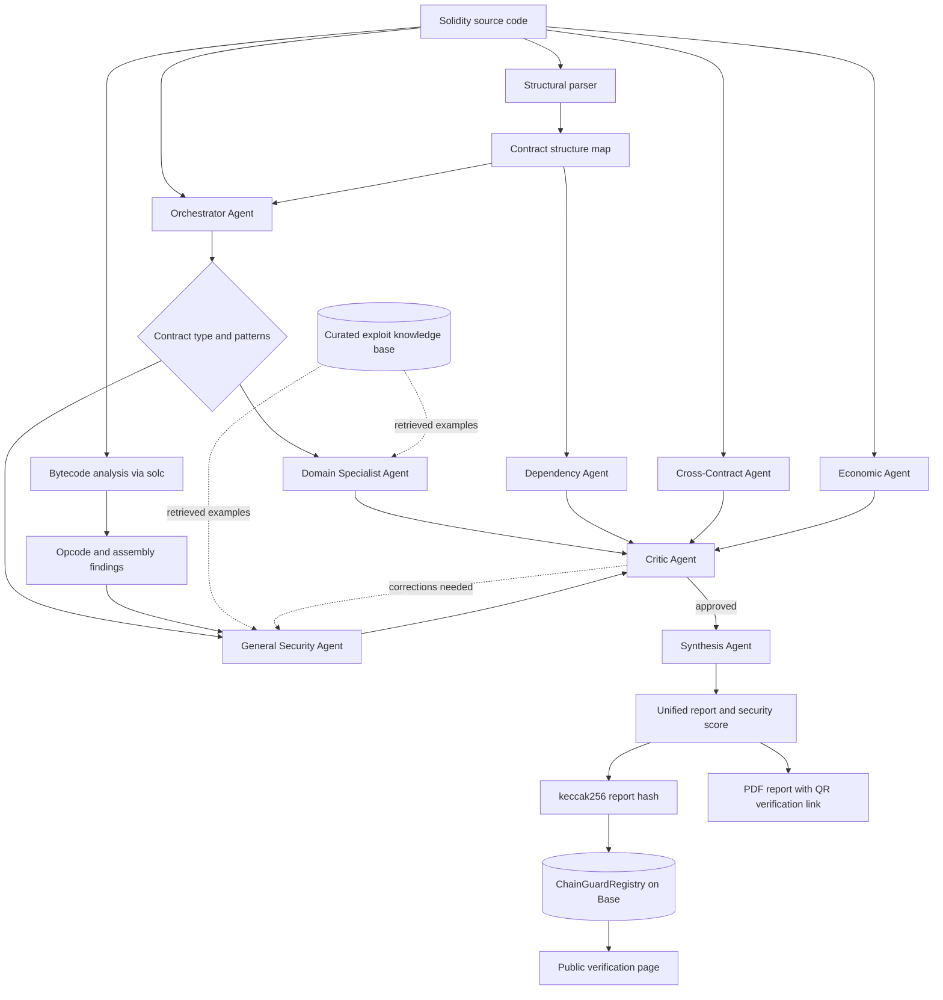

# Architecture

This document explains how ChainGuard is designed: how a raw Solidity file becomes a structured, scored, on-chain-verifiable security report. It describes the design and the reasons behind it. It is not a build manual.

## Overview

ChainGuard analyzes a contract in several steps. Sending the code to an LLM with a single prompt has two failure modes. It reports vulnerabilities that don't exist (false positives), and it skips functions or vulnerability classes it wasn't pointed at (false negatives). The pipeline below is designed to reduce both.

Before any model sees the contract, ChainGuard runs a **deterministic pre-analysis stage**. A structural parser extracts the contract's real shape: its functions and their visibility, modifiers, state variables, inheritance chain, imported dependencies, and a set of "dangerous pattern" flags (`delegatecall`, `selfdestruct`, `tx.origin`, assembly blocks, timestamp usage, and so on). In parallel, the contract is compiled with `solc` and its bytecode is inspected at the opcode level. This produces ground-truth facts (*this contract actually contains a `DELEGATECALL` opcode*) that the agents can be checked against later.

The analysis itself is performed by a **pipeline of specialized agents**. An orchestrator first classifies the contract (DeFi, NFT, Gaming, RWA, DAO, or Generic) and routes it accordingly. Five analysis agents then run **in parallel**, each with a narrow remit and its own system prompt: a domain specialist, a general-security agent, a dependency agent, a cross-contract interaction agent, and an economic-security agent. A **critic agent** then reviews all five reports against the structural ground truth, hunts for contradictions, false positives, and unchecked functions, and can trigger a bounded correction loop. Finally a **synthesis agent** merges everything into one deduplicated report and computes the final score with a transparent penalty model.

In the last stage, the finished report is hashed with `keccak256`, and that hash, together with the score and a timestamp, is committed to an **append-only registry contract on Base**. From that point, anyone can confirm that a specific report existed at a specific block height, without relying on ChainGuard's servers or database.

## Pipeline diagram

## The agents

Each analysis runs seven agents plus an **orchestrator**. The orchestrator classifies the contract and routes it. Then come five analysis agents that run in parallel, a critic and a synthesis agent. All of them call the Claude API at temperature 0 to reduce variance.

**Orchestrator.** Classifies the contract into a domain and a set of architectural patterns (AMM, lending, staking, ERC-721, governance, …), then decides which domain specialist to activate. This routing step sends each contract to the specialist that covers its domain.

**Domain Specialist.** One of six personas (DeFi, NFT, Gaming, RWA, DAO, or Generic), activated by the orchestrator. Each persona checks the vulnerability classes that matter for its domain. For DeFi, that means AMM and oracle manipulation and flash-loan vectors. For NFT, `_safeMint` callbacks, royalty bypass and lazy-mint signature replay. For Gaming, randomness and PRNG weaknesses. For RWA, proxy/upgrade and compliance risks. For DAO, vote manipulation, timelock bypass and governance attacks.

**General Security.** A domain-agnostic agent that explicitly walks a fixed checklist of vulnerability classes (reentrancy, integer overflow/underflow, access control, unchecked external calls, front-running/MEV, oracle manipulation, flash loans, denial of service, timestamp dependence, `tx.origin` misuse, `delegatecall` risks, centralization, and signature issues) and is required to report "not found" for each class it clears, so that no class is skipped without a trace.

**Dependency.** Receives only the imports, inheritance chain, and structural map, never the full source. It reasons about known issues in specific OpenZeppelin versions, dangerous inherited patterns, and missing recommended dependencies (a contract that handles ETH but never inherits `ReentrancyGuard`, an upgradeable contract without `Initializable`, and so on).

**Cross-Contract.** Focuses on the seams between contracts: untrusted external calls, reentrancy through token callbacks, dependence on manipulable external state such as oracle prices or pool reserves, and atomic cross-contract attacks.

**Economic.** Analyzes incentives and game theory rather than code correctness: a contract can be technically flawless and still economically exploitable. It looks for misaligned incentives, MEV extraction surfaces, unsustainable tokenomics, and flash-loan-enabled economic attacks.

**Critic.** It receives all five analysis reports plus the structural and bytecode ground truth, and looks for contradictions between reports, false positives that aren't real given the contract's context and Solidity version, vulnerabilities every agent missed, and incorrect severity assignments. If it rejects the analysis, a bounded correction loop re-runs the affected agent with the critic's feedback.

**Synthesis.** Merges the reviewed reports into one report: deduplicates overlapping findings, applies the critic's corrections, and computes the final 0–100 score with an explicit penalty model (each finding subtracts a fixed amount by severity).

## Design decisions

### Deterministic pre-analysis grounds the model

The LLM never works from raw source alone. The structural parser and `solc` bytecode pass run first and hand every agent a parsed contract map and verified opcode facts. This is meant to improve recall (not measured yet), because agents are pointed at every function and every dangerous pattern explicitly. It also gives the critic a reference to check against. When an agent claims a contract uses `delegatecall`, that claim can be checked against the compiled bytecode.

### Separating finding from judging

Finding and judging are split into different agents with different prompts. When one model both finds bugs and decides which of its own findings are wrong, the output tends to be either timid or over-confident. Here the analysis agents aim for recall, a separate critic aims for precision, and a bounded correction loop sits between them.

### Retrieval over real exploits

The analysis agents are grounded with retrieval-augmented generation over a curated knowledge base of documented real-world DeFi exploits, with vulnerable-and-fixed code pairs. Retrieval is filtered by the contract's domain, so a DeFi contract is compared against DeFi hacks. Findings can then point to a known precedent (*this resembles the pattern behind a specific historical exploit*).

### On-chain proof decoupled from the application

The analysis report is hashed and the hash is written to an append-only registry contract on Base. The application itself is never the source of truth for "this was analyzed." The registry is intentionally minimal (it stores hashes, scores, timestamps, and block numbers, not report contents), with a per-contract version cap to bound gas and an approved-submitter allowlist. Anyone can later read the registry directly and confirm a report's existence and timing independently of ChainGuard. Reports also export as a PDF carrying a QR code that points straight to the public verification page.

---

*This is a public showcase repository. The ChainGuard source code is private. See [README.md](README.md) for project context and contact details.*
