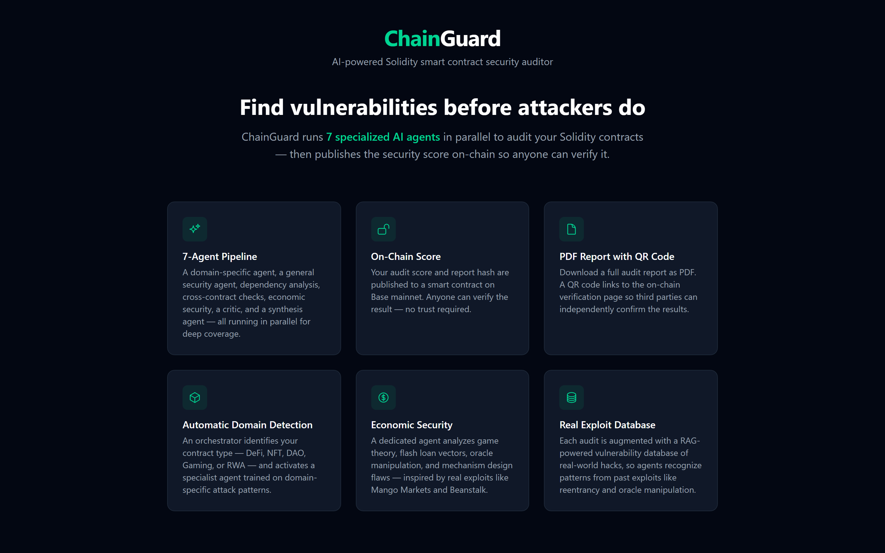
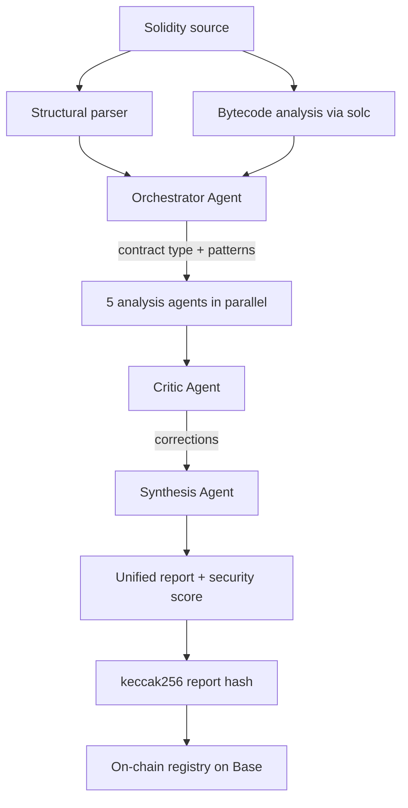

# ChainGuard

> AI-powered security scanner for Solidity smart contracts: multi-agent vulnerability analysis with on-chain proof of review.

**In production:** [chainguard-theta.vercel.app](https://chainguard-theta.vercel.app)

## The problem

Smart contracts cannot be changed once deployed, so a bug stays in production. Professional audits are expensive and out of reach for early-stage protocols, small teams, or projects iterating fast. Static analyzers like Slither flag the same patterns repeatedly without context.

## What ChainGuard does

ChainGuard runs a Solidity contract through seven agents plus an orchestrator. The orchestrator classifies the contract. Five analysis agents then run in parallel (domain specialist, general security, dependencies, cross-contract interactions, economic security). A critic challenges their findings, and a synthesis agent writes the final report. The pipeline produces:

- A **security score** (0–100) capturing overall risk
- A list of **vulnerabilities prioritized by criticality** (Critical / High / Medium / Low / Economic)
- For each vulnerability: **why it matters, where it is, how to fix it**, and for high-severity findings a plain-English attack scenario
- A **cryptographic hash of the report stored on-chain**: a tamper-proof timestamp of the analysis

Anyone can check on-chain when a contract was analyzed and what score it got, without relying on ChainGuard's own database.

## How it works

The analysis pipeline parses the contract, classifies it, fans out to five specialized analysis agents running in parallel, runs an adversarial critic pass, then synthesizes a single deduplicated report. The report hash is committed to a registry contract on Base.

Full breakdown of the agents, design decisions, and the on-chain proof mechanism in **[ARCHITECTURE.md](ARCHITECTURE.md)**.

## Tech stack

**Frontend & app**
- Next.js 15 (App Router), React 19, TypeScript
- Tailwind CSS v4
- Deployed on Vercel

**AI analysis**
- Anthropic Claude (Sonnet) via the official `@anthropic-ai/sdk`
- Custom multi-agent orchestration (no agent framework, hand-built pipeline)
- Retrieval-augmented generation over a curated database of documented DeFi exploits
- `solc` for in-pipeline Solidity compilation and bytecode/opcode inspection

**Blockchain**
- Solidity 0.8.20 contracts (OpenZeppelin), deployed on **Base mainnet**
- `ethers` v6 for on-chain reads/writes and wallet interaction
- On-chain analysis registry storing report hashes, scores, and timestamps

**Auth**
- GitHub OAuth sign-in (NextAuth) for identity and usage tracking

**Reporting**
- `jsPDF` + `qrcode`: exportable PDF reports with a QR code linking to the on-chain verification page

## Roadmap

**Shipped**
- [x] MVP live
- [x] Analysis pipeline with seven agents plus an orchestrator, including an adversarial critic
- [x] Per-protocol specialization: six domain agents (DeFi, NFT, Gaming, RWA, DAO, Generic)
- [x] RAG over a curated database of documented real-world DeFi exploits
- [x] On-chain report hashing on Base
- [x] Verifiable PDF reports with on-chain QR proof

**Next**
- [ ] Pre-audit mode: lightweight scan tuned for surfacing medium/low findings before engaging a top-tier auditor
- [ ] Eval suite against known-vulnerable benchmarks (Damn Vulnerable DeFi, SWC registry) with published detection-rate metrics
- [ ] Public benchmarks vs. existing static analyzers (Slither, Mythril)

## Limitations

Detection rate not measured yet. The evaluation against known-vulnerable benchmarks is the next item on the roadmap.

## Background

MSc in Cybersecurity & AI, EFREI Paris (2026).

## Source code

The source code is private. This repository presents the architecture, the design decisions and the capabilities of the system. Designed and deployed by Mathieu Recatala, developed with Claude Code.

## Contact

- GitHub: [github.com/mathieurecatala](https://github.com/mathieurecatala)
- LinkedIn: [linkedin.com/in/mathieu-recatala-0360b5222/](https://www.linkedin.com/in/mathieu-recatala-0360b5222/)
- Site: [chainguard-theta.vercel.app](https://chainguard-theta.vercel.app)
